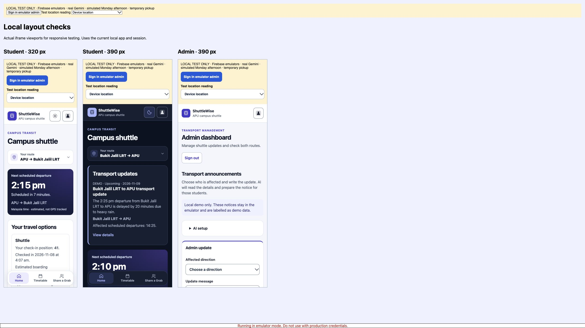
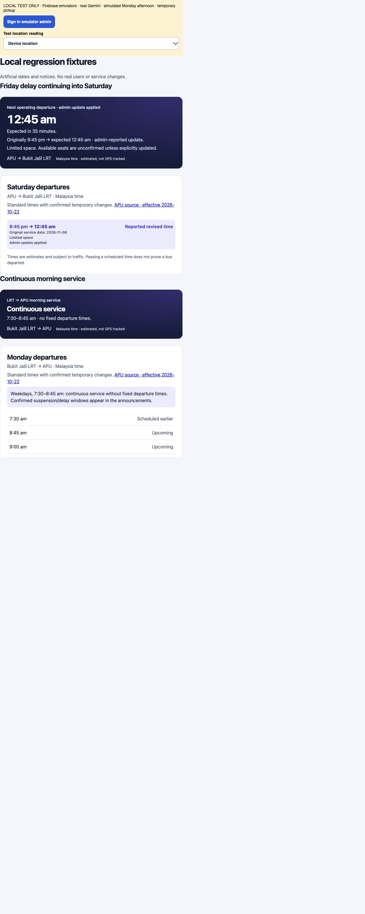

# Full feature check — 8 November 2026

Final results: **26 unit/Worker checks, 8 Firestore emulator checks, 11 real Gemini checks, and the production build passed.** Browser checks used the local app, two student sessions, a local admin, real Gemini, and Firebase emulators.

The hosted website is still blocked by its missing Worker URL/App Check setup and the friend's Firebase permissions. These results do not certify the deployed website. No live Firebase data or deployed rules were changed.

## Fixes made

1. A Friday departure delayed past midnight appeared on Home but disappeared from Saturday's Timetable. Timetable now includes that effective departure and shows its original service date.
2. Invalid notice feedback still asked for title/summary/source fields that were removed. It now asks the admin to correct the original message and read it again.
3. Real Gemini extraction incorrectly requested shuttle times for an information-only event notice. The prompt now accepts general information without inventing an operational change or requiring shuttle departure times.

## Browser checks

| Feature | Checked result |
| --- | --- |
| Standard timetable | Both directions displayed the standard times. Home and Timetable used the same effective schedule. Limited-space labels remained visible. |
| Countdown and queue | Countdown refreshed. Next bus and estimated boarding bus remained separate. Sample position 41 used bus two with sample capacity 24. |
| Admin → student | Real text extraction, inline result, publication, immediate student update, correction and withdrawal passed. Queue entries remained intact. |
| Direction isolation | APU-only changes did not affect LRT → APU. Both-direction correction applied separate departures and delays. Route switching cleared the old route's queue position and notice display. |
| Reordered departures | Delaying APU's 14:30 trip by 40 minutes showed 15:10 in Timetable; an earlier operating bus became the boarding option. |
| Notice image | Uploaded the public PNG through the real image preparation function. It was converted to JPEG, read by real Gemini, reviewed and published. LRT's 14:25 trip became 14:45. |
| Unknown delay | No invented revised time; personal boarding estimate became unavailable while other known departures remained visible. |
| Cancellation | A cancelled LRT departure displayed as cancelled. Withdrawal restored its original schedule. |
| Invalid input | Missing times/reason blocked publishing. A direction contradicting the source was blocked. Editing source text removed the previous publish action. |
| AI failure | A deliberate provider failure kept the message and offered no publish action. Existing timetable and Grab options remained usable. |
| Grab host/join | A checked-in host created a room; an independently signed-in student joined. Both saw the roster and fare update immediately. |
| Fare/leave/cancel | RM16 updated to RM24 and both saw the correct per-person share. Leaving reduced the member count. Cancelling removed the open room. Original queue positions remained 41 and 42. |
| Depart/board/queue leave | Marking a Grab departed retained the shuttle check-in. “I got the bus” removed only that student's check-in. The other student could leave the original APU queue while viewing LRT. |
| Location | Provided coordinates with 35m accuracy were rejected by the existing 30m requirement. A simulated 10m reading at the temporary pickup passed. Wrong coordinates, permission denial, and checking the other pickup were rejected. |
| Continuous service | At the morning fixture time, LRT → APU showed continuous service and no invented exact countdown. |
| Midnight boundary | Friday's delayed 21:45 departure appeared on Saturday at 00:45 in both Home and Timetable. |
| Responsive layout | Actual 320px and 390px iframe viewports had no horizontal overflow; admin at 390px also fitted. Student light/dark themes were inspected. Normal desktop pages fitted too. |
| Browser errors | No unexpected application errors remained in the checked flows. See `browser-errors.json`. |
| Existing admin briefing | With its provider setup unavailable, it displayed the existing fallback and kept the calculated history visible. Its live provider connection is not verified. |

## Automated checks

| Command | Final result |
| --- | --- |
| `npm test` | 26 passed, 0 failed |
| `FIRESTORE_EMULATOR_HOST=127.0.0.1:8080 node --disable-warning=ExperimentalWarning --experimental-strip-types --test tests/firestore.mjs` | 8 passed, 0 failed |
| `npm run test:ai:live` | 11 real provider checks passed, 0 failed |
| `npm run build` | Passed; existing large-bundle warning remains |
| `git diff --check` | Passed |

The emulator suite covers each Grab direction, check-in requirements, invalid fares, host-only actions, private rosters, cancellation, wrong-route rejection, simultaneous joins, full rooms, preserved queue entries/history, admin permissions, and concurrent notice conflicts. Closed ride records remain accessible to their original participants; outsiders cannot read them.

The unit/Worker suite also covers notice expiry, supersession, withdrawal, unknown duration, Malaysia date boundaries, queue/capacity boundaries, fare ranking, stale data, AI response validation, origin checks, Firebase token verification, App Check, rate limiting, and provider failures. Auth/App Check verification uses signed test fixtures; hosted verification remains pending.

The live suite covers APU text, LRT image, both directions, unknown delay, cancellation, suspension, replacement, pickup, capacity, general information, and student advice. Actual responses: [live provider results](../ai-live-validation/results.json). Browser adapter responses: [real AI browser results](real-ai-browser-results.jsonl).

## Test environment and limits

- Browser data used only local project `demo-shuttlewise`. Sample capacity, fares and people are labelled demo data.
- A disposable local adapter called the production extraction/advice functions with the real Gemini key. Browser publication and ride transactions used the real emulator rules. The adapter replaced only unavailable hosted transport/App Check and sign-in setup; it was not added to the production app.
- Browser timetable tests used a simulated Monday afternoon. The separate regression fixtures used explicit Friday/Saturday and Monday morning dates. The normal app clock was not changed.
- The supplied M Vertica point was used only as a temporary local process setting and location fixture. A real device GPS reading could not be confirmed in this browser. The successful test used a simulated accurate reading; no production pickup setting was changed by this test.
- Temporary servers and emulator sessions started for these checks were stopped. The user's existing development server was preserved.
- Hosted Google sign-in, App Check, Cloudflare deployment, the friend's current Firestore rules, physical pickup accuracy, and two actual phones still need live verification. See [owner setup steps](../../AI_SETUP.md).

## Repeating the checks

Run `npm test`, `npm run test:rules`, and `npm run build` from the app folder. `npm run test:ai:live` additionally uses the ignored local Worker key and normal Gemini quota.

For visual regression checks while the local app server is running, open `/tests/travel-ui.html` for midnight/continuous-service fixtures and `/tests/layout-ui.html` for actual phone-width page frames. These test pages are not production build entries. The disposable real-AI browser adapter was temporary and is not enabled by `npm run dev:local`.

